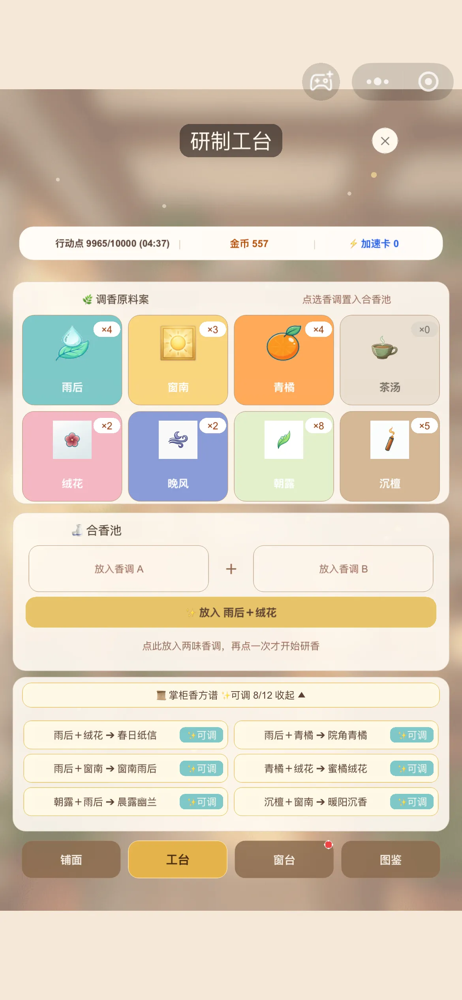
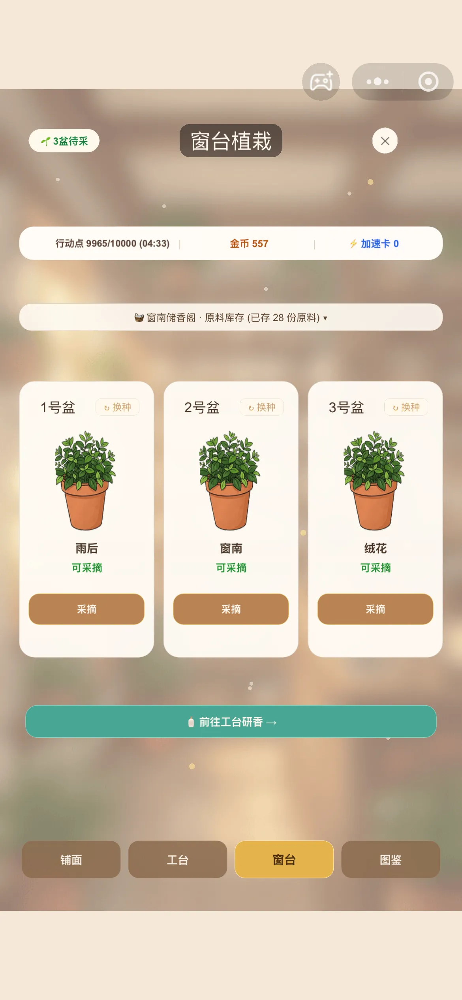

# 窗南香氛铺 (Chuang Nan Xiangfen)

> 一款基于 Cocos Creator 3.8 与 TypeScript 开发的休闲治愈系调香模拟经营微信小游戏。

<p align="center">
  <br>
  <sub>📱 微信扫码立即体验</sub>
</p>

---

## 📌 项目状态说明

> **【项目状态：已完结 / 归档（Archived / As-is）】**  
> 本项目已完成全部核心玩法闭环与跨平台体验验证。原开发团队目前已停止后续功能迭代，项目源码与架构现整体开放，仅供游戏开发爱好者、独立开发者交流与学习参考。

---

## 📸 游戏界面预览

| ① 铺面经营 | ② 研制工台 | ③ 窗台植栽 | ④ 藏香图谱 |
| :---: | :---: | :---: | :---: |
|  |  |  |  |
| <sub>客单交互与货架陈列</sub> | <sub>自由合香与掌柜香谱</sub> | <sub>原料采摘与储香阁</sub> | <sub>12款香氛全图鉴收集</sub> |

---

## ✨ 核心玩法闭环

1. **窗台采摘原料**：定时刷新 8 种基础香调原料（朝露、晚风、沉檀、绒花等），点击采摘收取入库。
2. **工台调香出瓶**：在工作台自由选择 2 种香调原料进行调和。根据配方表生成 12 种不同标签与外观的特色香水，未匹配配方则产出练习瓶。
3. **客人订单交互**：接待不同生活背景与气味偏好的客人，根据其标签需求挑选合适的香水进行交付，收获虚拟金币与好感。
4. **货架陈列经营**：将调配好的香水陈列于前台货架上供客人选购，支持店铺装扮与空间布置。
5. **香氛图鉴收集**：完整记录研发成功的香水故事、瓶型外观与属性标签，提供丰富的收集成就感。
6. **轻量节奏控制**：通过行动点数（AP）与加速卡管理游戏节奏，无强制等待。

---

## 🛠️ 技术特点与架构

- **游戏引擎**：Cocos Creator 3.8.x（基于 2D UI 与组件化节点架构）
- **开发语言**：TypeScript
- **架构设计**：
  - **数据表驱动**：玩法数值、调香配方、客人对白、图鉴说明全部配置在 `assets/tables/*.json` 中，逻辑与数据高度解耦。
  - **纯本地持久化**：采用微信小游戏轻量化存储接口 `wx.getStorageSync` / `wx.setStorageSync`，完全不依赖外部后端服务器与数据库。
  - **零外部敏感接口**：无内购充值、无第三方 SDK 强绑定，广告通道已进行 Mock 抽象解耦。

---

## 📂 目录结构说明

```text
├── assets/
│   ├── art/          # 美术资产（瓶型、客人立绘、场景背景、UI图标）
│   ├── audio/        # 音效与氛围背景音乐（极轻 procedural 音频）
│   ├── scenes/       # 主场景（Main.scene）
│   ├── scripts/      # 核心 TypeScript 脚本源码
│   │   ├── ads/      # 广告接口抽象与 Mock
│   │   ├── core/     # 核心游戏状态机、事件总线、数据存储 (Storage)
│   │   ├── logic/    # 调香合成、订单匹配、客人来访等业务逻辑
│   │   └── ui/       # 各玩法界面面板与交互组件
│   └── tables/       # 数值配置表（recipes.json, guests.json, bottles.json 等）
├── extensions/       # Cocos Creator 扩展插件（内置 cocos-mcp-3x 桥接工具）
├── settings/         # Cocos Creator 3.8 项目设定与分辨率适配
├── tests/            # 离线自动化逻辑检查与布局验证脚本
├── COPYING.md        # 详细版权、素材使用与免责声明
├── LICENSE           # MIT 开源许可证
└── SPEC.md           # 游戏玩法与系统设计规格书
```

---

## 🚀 快速上手与运行

### 1. 使用 Cocos Creator 运行
1. 下载并安装 [Cocos Dashboard](https://www.cocos.com/)，安装 **Cocos Creator 3.8.x**（推荐 3.8.8）。
2. 打开 Cocos Dashboard，选择「导入」，选择本项目所在文件夹。
3. 导入完成后双击打开项目，进入编辑器。
4. 在资源管理器中打开 `assets/scenes/Main.scene`。
5. 点击编辑器顶部工具栏的 **「预览」** 按钮（或快捷键 `Ctrl + P`），即可在浏览器中体验完整玩法。

### 2. 构建为微信小游戏
1. 在 Cocos Creator 顶部菜单栏点击 **项目 -> 构建发布**。
2. 发布平台选择 **微信小游戏 (WeChat Mini Game)**。
3. 填入你的小游戏 AppID，点击「构建」。
4. 构建完成后，使用「微信开发者工具」导入 `build/wechatgame` 目录即可真机调试。

### 3. 运行离线逻辑自检
本项目内置了自动化检查脚本，可在不启动引擎界面的情况下快速校验逻辑：
```bash
# 检查数据表与配方逻辑
npm run check

# 检查 UI 布局与文本规格
npm run check:ui
```

---

## ⚖️ 版权与免责声明 (License & Disclaimer)

本项目开源受以下条款约束，详情请见 [COPYING.md](COPYING.md)：

1. **代码授权**：本项目相关程序源代码基于 **MIT 协议** 授权，可供自由学习、研究与修改。
2. **美术资源限制**：本项目中所有的美术图像资源（包括但不限于背景、瓶子、香调图标、客人立绘等）**均为 AI 生成工具辅助制作的测试素材**，仅供学习、交流和功能验证使用。**严禁直接用于商业环境**；如需商用，请自行替换为合法商业授权资源。
3. **内容虚构**：游戏中涉及的任何香调属性、瓶型名称、客人对白、配方效果均为艺术虚构，与现实中任何真实品牌、香水商品功效、医疗承诺均无关联。
